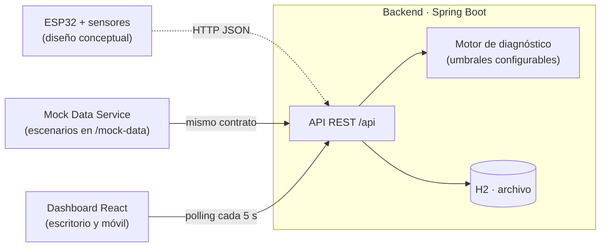

# EcoCompost IoT

Sistema de monitoreo inteligente para una compostera doméstica en una pensión estudiantil de Santa Marta. Trabajo final del curso **Diseño y Prototipado** (código 4011125), Universidad del Magdalena, Ingeniería de Sistemas, periodo 2026-II. Docente: Sabina Rada Mendoza.

> ⚠️ **Los datos de temperatura y humedad son simulados.** Con autorización de la docente, el trabajo se centra en software e IoT. El nodo físico (ESP32 + sonda DS18B20 + sensor capacitivo de humedad de suelo) es un diseño conceptual. Un *Mock Data Service* reemplaza al hardware y envía lecturas por el mismo contrato de API que usaría el ESP32. Los pesajes de residuos sí son reales y fueron medidos por el equipo.

## Problema

En la casa de Jenis se cocina a diario para más de 12 personas (los dueños y 10 estudiantes). El pesaje propio de 5 días dio **19,5 kg de residuos orgánicos (3,9 kg/día en promedio)**. Hoy esos residuos van en bolsas que escurren y que Cande, encargada del aseo, debe retirar. El esposo de Jenis compra abono para su terraza.

**Pregunta reto (HMW):** ¿Cómo podríamos diseñar una compostera tecnificada e instrumentada con sensores IoT para una pensión estudiantil en Santa Marta, que convierta los altos volúmenes de desechos de la cocina de Jenis en abono para la terraza de su esposo, automatizando el monitoreo para que Cande no tenga trabajo extra de limpieza?

**Decisión:** compostera aeróbica tecnificada con monitoreo IoT. Se descartó el biodigestor por seguridad (metano, presión y olores).

## Arquitectura



El análisis completo (requisitos, C4, modelo de datos, ADR, backlog y plan) está en [docs/analisis-arquitectura-entregable-3.md](docs/analisis-arquitectura-entregable-3.md).

## Estructura del repositorio

| Carpeta | Contenido |
|---|---|
| `backend/` | API REST en Spring Boot 4 (Java 21, Maven Wrapper, JPA, H2) |
| `frontend/` | Dashboard en React + Vite + TypeScript |
| `mock-data/` | Escenarios JSON de la demo (los usa el simulador del backend y el modo offline del frontend) |
| `docs/` | Arquitectura, decisiones (`adr/`), bitácoras (`bitacoras/`) y evidencias (`evidencias/`) |

## Cómo ejecutar

Requisitos: **Java 21** y **Node.js 24** (ver `frontend/.nvmrc`). No hace falta instalar Maven ni una base de datos: el backend usa H2 en un archivo dentro de `backend/data/`.

Hay que levantar primero el backend y luego el frontend, en dos terminales.

**1. Backend** (puerto 8080). Arranca con el perfil `mock`, así que el simulador envía lecturas solas cada 5 segundos:

```bash
cd backend
./mvnw spring-boot:run
```

En Windows (cmd o PowerShell) se usa `mvnw.cmd spring-boot:run`. La primera ejecución descarga dependencias de Maven y tarda más. Comprobación: <http://localhost:8080/actuator/health> debe responder `UP`.

**2. Frontend** (puerto 5173; las llamadas a `/api` se redirigen al backend):

```bash
cd frontend
npm install
npm run dev
```

Abrir <http://localhost:5173>.

**Pruebas y build:**

```bash
cd backend && ./mvnw verify
cd frontend && npm run build
```

## Endpoints

Contrato del prototipo (detalle en la sección 2.5 del análisis de arquitectura). Las rutas marcadas *pendiente* aún no existen y responden 404.

| Método | Ruta | Descripción |
|---|---|---|
| `POST` | `/api/lecturas` | Registrar una lectura (contrato del ESP32 y del simulador). Responde `201` |
| `GET` | `/api/lecturas/actual` | Última lectura y estado de conexión (`EN_LINEA` o `SIN_CONEXION`). Responde `204` si no hay lecturas |
| `GET` | `/api/lecturas?desde=&hasta=` | Historial por rango. `desde` y `hasta` son obligatorios, en ISO-8601 (ej. `2026-10-28T00:00:00Z`) |
| `GET` | `/api/diagnostico` | Estado de temperatura y humedad, fase del compostaje y acciones |
| `GET` | `/api/alertas?estado=` | Alertas. `estado` puede ser `abiertas`, `atendidas` o `todas` (por defecto) |
| `PATCH` | `/api/alertas/{id}/atender` | Marcar una alerta como atendida |
| `GET` | `/api/demo/escenarios` | Escenario activo y escenarios disponibles (solo perfil `mock`) |
| `POST` | `/api/demo/escenario` | Cambiar el escenario del simulador, body `{"nombre":"humedad-baja"}` (solo perfil `mock`) |
| `GET`/`POST` | `/api/cargas` | Cargas de residuos (pesaje real). *Pendiente* |
| `GET` | `/api/umbrales` | Umbrales vigentes con su fuente. *Pendiente* |

Ejemplo de lectura, tal como la enviaría el ESP32:

```bash
curl -X POST http://localhost:8080/api/lecturas \
  -H "Content-Type: application/json" \
  -d '{"dispositivoId":"esp32-01","medidoEn":"2026-10-28T14:05:00Z","temperaturaC":58.2,"humedadPct":55.0,"origen":"MANUAL"}'
```

## Umbrales y fuentes

Los rangos de diagnóstico salen del *Manual de compostaje del agricultor* de la FAO (Román, Martínez y Pantoja, 2013): temperatura normal 45–65 °C con problema sobre 70 °C o bajo 35 °C, y humedad ideal 45–60 %. Los márgenes de aviso que agregó el equipo están declarados como criterio propio. Todo vive en configuración (`application.yml`), no en el código. El respaldo de cada dato, con página, está en [docs/referencias.md](docs/referencias.md).

## Equipo

| Integrante | Rol de coordinación |
|---|---|
| Bryan Andre Robles Mojica | Líder de usuarios *(por confirmar)* |
| Karyme Judith Sánchez Fernández | Líder de documentación *(por confirmar)* |
| Jussi Torres González | Líder técnico *(por confirmar)* |

Los roles coordinan; no reparten el trabajo técnico. Todos participan en backend, frontend y documentación. Ver [CONTRIBUTING.md](CONTRIBUTING.md).

## Licencia

[MIT](LICENSE)
