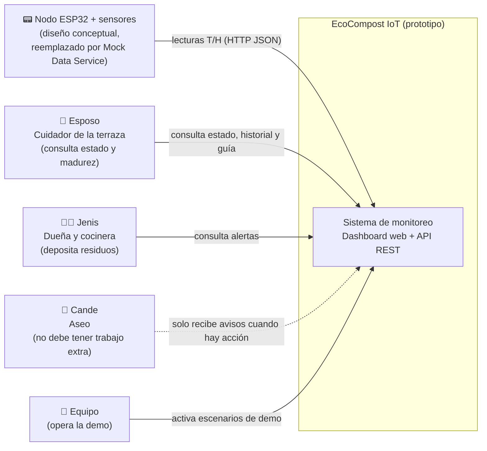
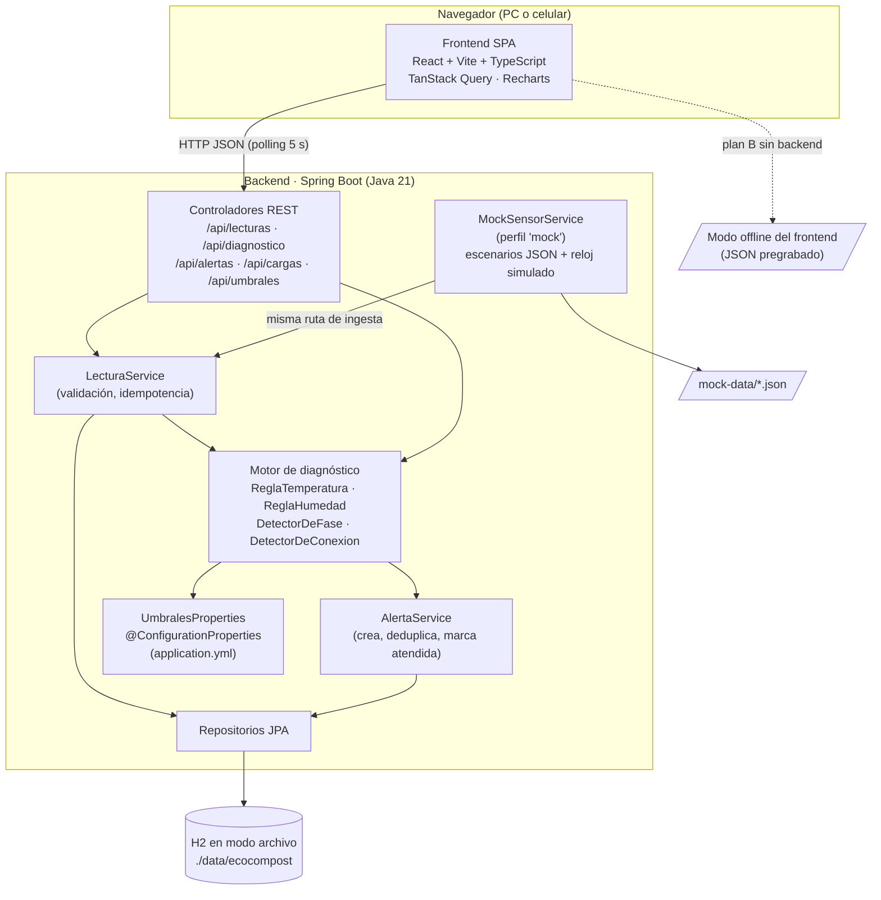
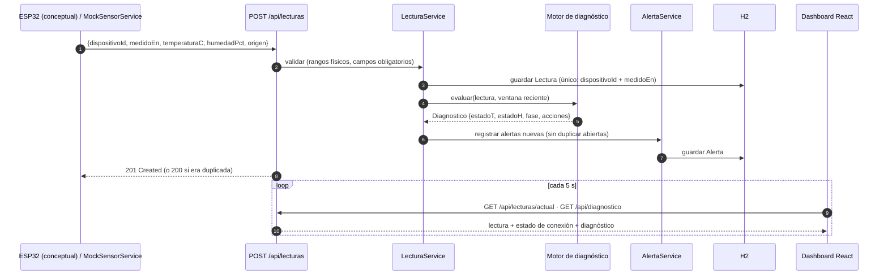
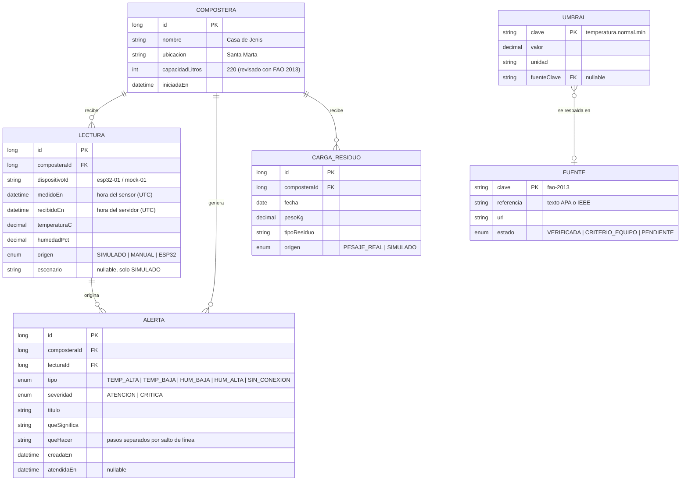
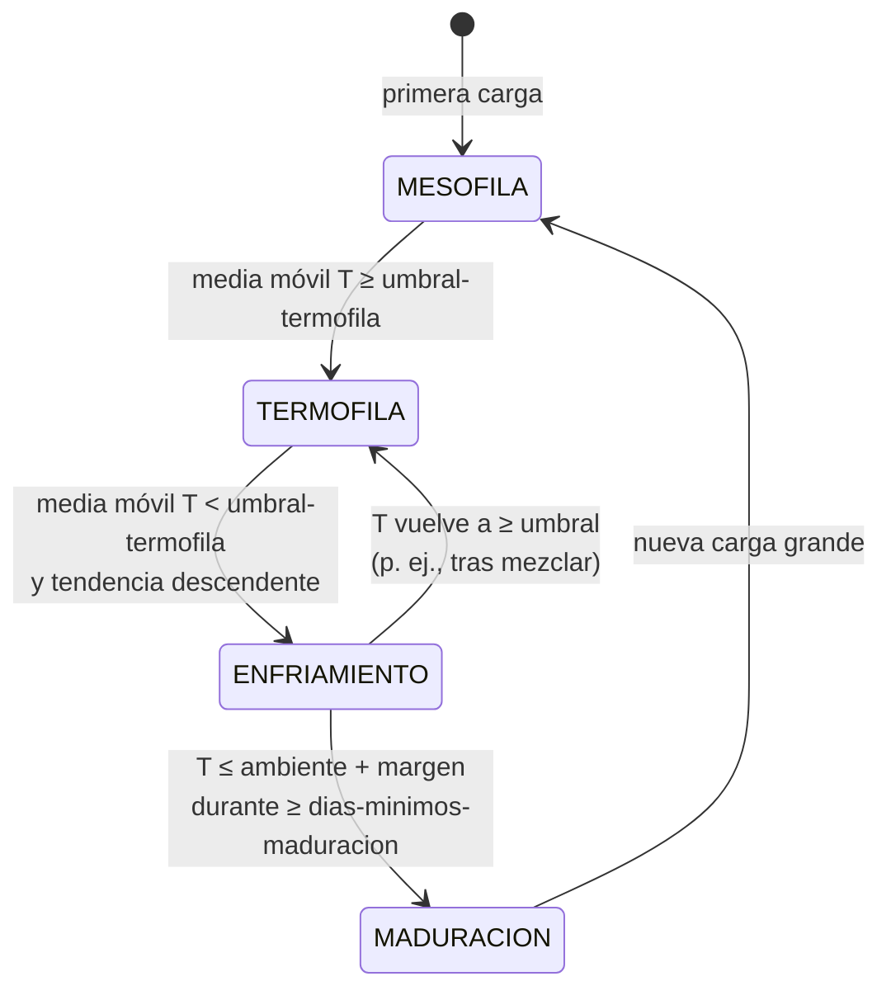
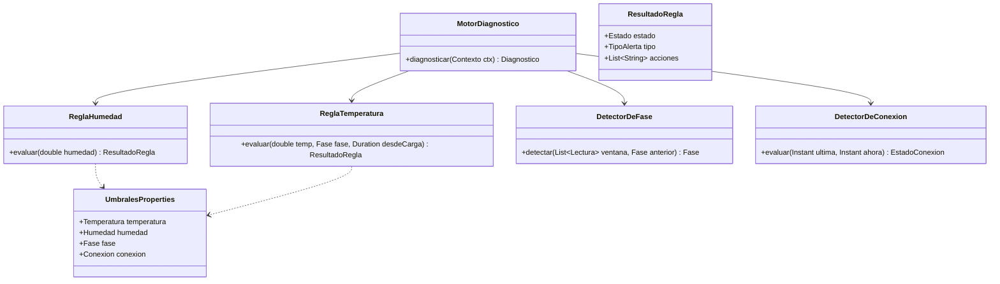
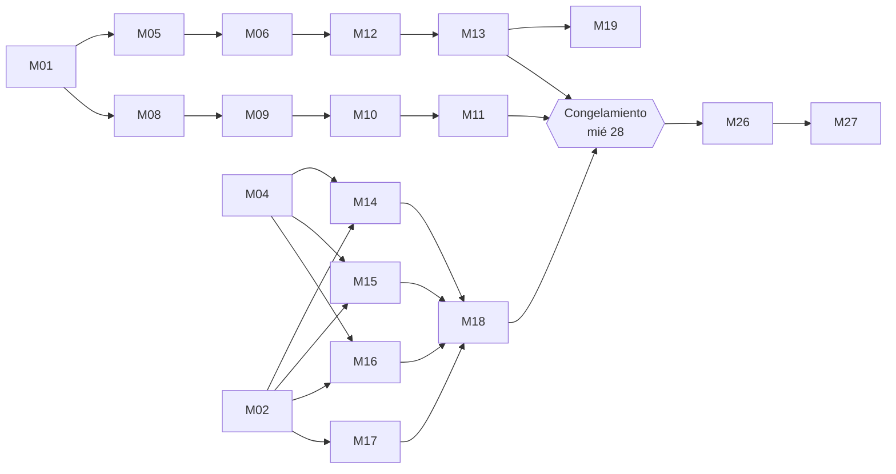

# Análisis de arquitectura · Entregable 3 · EcoCompost IoT

> **Proyecto:** EcoCompost IoT — sistema de monitoreo inteligente para compostera doméstica
> **Curso:** Diseño y Prototipado (4011125) · Universidad del Magdalena · 2026-II · Docente: Sabina Rada Mendoza
> **Equipo:** Bryan Andre Robles Mojica · Karyme Judith Sánchez Fernández · Jussi Torres González
> **Entrega:** Actividad evaluativa N.° 3 — viernes 30 de octubre de 2026 (150 puntos, 30 %)
> **Versión del documento:** 0.1 · 25 de octubre de 2026 · Borrador para revisión del equipo

**Fuentes internas usadas como verdad:** `docs/fuentes/Trabajo final - Biodigestor educativo.pdf` (guía de la docente), `docs/fuentes/Entregable_1.pdf` y `docs/fuentes/Entregable_2.pdf`.

> **Actualización (25 de octubre de 2026):** los umbrales y las recomendaciones ya tienen fuente verificada (FAO, 2013) o están declarados como criterio del equipo. El detalle por dato, con página, está en [referencias.md](referencias.md). Las secciones 4.2, 4.3 y 11 reflejan los valores nuevos.

**Convención de este documento.** Todo valor marcado con ⚠️ **SUPUESTO** es una propuesta del equipo que aún no tiene fuente citada. La guía exige que *"los rangos de operación, los valores de alerta y las estimaciones de impacto deben venir de fuentes citadas y de mediciones propias"*; por eso esos valores se tratan como configuración reemplazable, nunca como verdad fija del código.

---

## Índice

1. [Análisis de requisitos del Entregable 3](#1-análisis-de-requisitos-del-entregable-3)
2. [Arquitectura propuesta](#2-arquitectura-propuesta)
3. [Decisiones técnicas (ADR)](#3-decisiones-técnicas-adr)
4. [Diseño de la capa de diagnóstico](#4-diseño-de-la-capa-de-diagnóstico)
5. [Gap analysis de la interfaz](#5-gap-analysis-de-la-interfaz)
6. [Backlog priorizado (MoSCoW)](#6-backlog-priorizado-moscow)
7. [Plan día por día (25–30 de octubre)](#7-plan-día-por-día-2530-de-octubre)
8. [Riesgos del proyecto de software](#8-riesgos-del-proyecto-de-software)
9. [Guion de la demo en vivo (15 min)](#9-guion-de-la-demo-en-vivo-15-min)
10. [Lista de verificación de entrega](#10-lista-de-verificación-de-entrega)
11. [Pendientes de evidencia y trazabilidad](#11-pendientes-de-evidencia-y-trazabilidad)
12. [Preguntas abiertas para el equipo](#12-preguntas-abiertas-para-el-equipo)

---

## 1. Análisis de requisitos del Entregable 3

### 1.1 De la rúbrica a requisitos

La guía define para la semana del 30 de octubre (etapa Prototipar): *"Con la lista de riesgos aprobada, construir el contenedor, instalar los sensores y poner en marcha la consulta de datos. Hacer la primera carga de residuos."* Con la autorización de la docente para centrar el trabajo en software e IoT, el contenedor y los sensores quedan como diseño conceptual, y la consulta de datos pasa a ser el núcleo demostrable.

| Criterio (peso) | Nivel Superior exige | Requisito derivado | Criterio de aceptación medible |
|---|---|---|---|
| Claridad y coherencia (20 %, SO 1) | Problema con evidencia de campo propia; el prototipo responde al punto de vista | **RF-01** El dashboard muestra el escenario real ("Casa de Jenis") y el impacto calculado con el pesaje propio | La pantalla de impacto muestra 19,5 kg / 5 días y 3,9 kg/día tomados de los datos de `CargaResiduo`, no escritos a mano en la UI |
| | | **RNF-01** Cada pantalla se justifica por un dolor del mapa de empatía | La presentación tiene una diapositiva que enlaza cada pantalla con un dolor (Cande: sin trabajo extra; esposo: no sabe compostar; Jenis: olores) |
| Originalidad (30 %, SO 2) | Varias alternativas exploradas; solución novedosa y justificada | **RF-02** Diagnóstico con acción recomendada en lenguaje sencillo (no solo números) | Cada alerta muestra "Qué significa" y "Qué hacer" con máximo 3 pasos |
| | | **RF-03** Detección automática de la fase del compostaje | El historial resalta la fase actual entre Mesófila, Termófila, Enfriamiento y Maduración |
| | | **RNF-02** Umbrales configurables sin recompilar (elemento propio frente a soluciones comerciales) | Cambiar un umbral en `application.yml` y reiniciar cambia el diagnóstico; existe una prueba que lo verifica |
| Aplicabilidad (30 %, SO 2) | Seguro, mide T y H, muestra los datos, funciona con residuos reales | **RF-04** Ingesta de lecturas por API (`POST /api/lecturas`) con el mismo contrato que usaría el ESP32 | Una petición `curl` con JSON válido devuelve `201` y la lectura aparece en el dashboard en ≤ 10 s |
| | | **RF-05** Consulta de la lectura actual, del historial por rango y del diagnóstico | Los 4 endpoints del borrador responden con datos coherentes; pruebas de integración en verde |
| | | **RF-06** Detección de sensor sin conexión | Si no llegan lecturas en 3 intervalos, la UI muestra "Sensor sin conexión · última lectura hace X min" |
| | | **RNF-03** Seguridad documentada (lista de riesgos R1–R5 aprobada) | Correo o acta de aprobación de la docente guardado en `docs/evidencias/` |
| | | **RNF-04** Honestidad de los datos | Banner permanente "Datos simulados" en todas las pantallas; cada lectura lleva `origen` (`SIMULADO`, `MANUAL`, `ESP32`) |
| Presentación y orden (20 %, SO 2) | Exposición clara, demo en vivo, participación de todo el equipo | **RNF-05** Demo reproducible y controlable | Los escenarios de demo se activan con un clic o un comando y producen siempre el mismo resultado (semilla fija) |
| | | **RNF-06** Plan B sin red ni backend | El frontend funciona en modo estático con datos pregrabados; existe video de respaldo ≤ 3 min |
| | | **RNF-07** Participación equitativa | El guion asigna a cada integrante al menos 4 min de exposición o demo |

**Requisitos no funcionales transversales (para un prototipo de 5 días):**

| ID | Requisito | Meta |
|---|---|---|
| RNF-08 | Usabilidad móvil | Las 4 pantallas se leen sin desplazamiento horizontal a 375 px de ancho |
| RNF-09 | Actualización "casi en tiempo real" | Latencia lectura→pantalla ≤ 10 s (polling cada 5 s) |
| RNF-10 | Arranque simple | Backend y frontend arrancan con un comando cada uno, sin instalar base de datos |
| RNF-11 | Calidad mínima | CI compila backend y frontend en cada PR; la capa de diagnóstico tiene pruebas unitarias |
| RNF-12 | Sin secretos en el repositorio | No hay credenciales en el código; el prototipo no las necesita |

### 1.2 ¿Qué parte de la rúbrica exige hardware real?

| Exigencia de la guía o la rúbrica | ¿Exige hardware? | Cómo se cubre con la autorización de software/IoT simulado |
|---|---|---|
| "Mide temperatura y humedad" | Sí, en sentido literal | Diseño conceptual del nodo (ESP32 + DS18B20 + sensor capacitivo, ya en E2) **más** un contrato de API idéntico al que usaría el ESP32. El Mock Data Service se comporta como el sensor: envía lecturas por el mismo camino. Se declara de forma explícita que la medición es simulada. |
| "Funciona con residuos reales" | Sí, en sentido literal | Ver 1.3. |
| "Es seguro" | Parcialmente | La seguridad del software (baja tensión es de hardware) se cubre con la lista de riesgos R1–R5 aprobada y con la guía de uso que exige guantes y tapabocas (R5). |
| "Construir el contenedor, instalar los sensores, primera carga de residuos" (plan de entregas) | Sí | Fuera de alcance por autorización. Se recomienda **guardar por escrito** esa autorización (correo de la docente) en `docs/evidencias/`. |
| "Muestra los datos" / "Forma de consultar los datos funcionando" | No | Es el núcleo del prototipo: dashboard + API. |

### 1.3 "Funciona con residuos reales": cómo evidenciarlo con honestidad

No se debe afirmar que el sistema midió una compostera real. Sí se puede demostrar que **el sistema está alimentado y calibrado por datos reales del escenario**:

1. **Las cargas de residuos son reales.** Se registran como entidad `CargaResiduo` los 5 pesajes medidos por el equipo (3,8 · 4,1 · 3,5 · 4,2 · 3,9 kg, con sus tipos de residuo). El dashboard calcula el impacto (kg desviados del camión) a partir de esas cargas.
2. **La simulación reacciona a las cargas.** El Mock Data Service usa la masa cargada como entrada: cada carga dispara el inicio de un ciclo de calentamiento. Así la curva simulada depende de un dato real del escenario, no de un valor arbitrario.
3. **Lectura manual opcional (recomendada, si el equipo puede).** Si el equipo mide con un termómetro de cocina la temperatura de una pila real de residuos de la casa, esa medición se registra por `POST /api/lecturas` con `origen = MANUAL` y se distingue en la gráfica. Una sola lectura real bien documentada (foto + hora) vale más que cien simuladas. *(Ver pregunta 5 en la sección 12.)*
4. **Etiquetado visible.** Cada punto de la gráfica indica su origen; el banner "Datos simulados" nunca se oculta.

Frase sugerida para la exposición: *"Los residuos y su peso son reales y medidos por nosotros; la telemetría de temperatura y humedad es simulada con un modelo del proceso, porque el hardware quedó como diseño conceptual con autorización de la docente. El sistema recibe datos del sensor por el mismo contrato que usaría el ESP32."*

---

## 2. Arquitectura propuesta

Estilo: **monolito modular** (un backend Spring Boot + un frontend SPA). Sin microservicios, sin colas de mensajes, sin contenedores obligatorios.

### 2.1 Vista de contexto (C4 nivel 1)



### 2.2 Vista de contenedores y componentes (C4 nivel 2)



**Decisión clave:** el `MockSensorService` **no escribe directo en la base de datos**; pasa por `LecturaService`, igual que una petición `POST /api/lecturas`. Así la demo ejercita la misma validación, el mismo diagnóstico y la misma generación de alertas que tendría el hardware real. Para mostrar el contrato del ESP32 en vivo, además se envía una lectura con `curl` (sección 9).

### 2.3 Flujo de datos sensor → API → base de datos → dashboard



Notas del flujo:

- **Idempotencia (riesgo R4).** El ESP32 conceptual guarda hasta 48 h de lecturas y las reenvía al recuperar el Wi-Fi. La restricción única `(dispositivoId, medidoEn)` evita duplicados en el reenvío. Se recomienda además `POST /api/lecturas/lote` (Should).
- **Tiempo.** Las fechas viajan en ISO-8601 UTC (`2026-10-28T14:05:00Z`); el frontend las muestra en `America/Bogota`.
- **Validación física.** Se rechazan con `400` lecturas imposibles (por ejemplo T < −10 °C o > 90 °C; H < 0 % o > 100 %). Esos límites son de plausibilidad del sensor, no de diagnóstico.

### 2.4 Modelo de datos



Simplificación para 5 días: los **umbrales viven en `application.yml`** (fuente de verdad de la lógica); la tabla `UMBRAL`/`FUENTE` es opcional (Should) y solo sirve para mostrar trazabilidad en la UI. Alternativa aún más simple: un `fuentes.yml` leído al arrancar y expuesto en `GET /api/umbrales`.

### 2.5 Contrato de la API (OpenAPI resumido)

```yaml
openapi: 3.0.3
info: { title: EcoCompost IoT API, version: 0.3.0 }
paths:
  /api/lecturas:
    post:
      summary: Registrar una lectura (contrato del ESP32 y del simulador)
      requestBody:
        content:
          application/json:
            schema: { $ref: '#/components/schemas/LecturaEntrada' }
      responses:
        '201': { description: Creada }
        '200': { description: Duplicada (mismo dispositivoId + medidoEn), no se vuelve a guardar }
        '400': { description: Valores fuera de rango físico o campos faltantes }
    get:
      summary: Historial por rango
      parameters:
        - { name: desde, in: query, required: true, schema: { type: string, format: date-time } }
        - { name: hasta, in: query, required: true, schema: { type: string, format: date-time } }
        - { name: composteraId, in: query, schema: { type: integer, default: 1 } }
        - { name: resolucion, in: query, schema: { type: string, enum: [cruda, hora, dia], default: hora } }
      responses:
        '200': { description: Lista de lecturas (promediadas según resolución) }
  /api/lecturas/actual:
    get:
      summary: Última lectura y estado de conexión del sensor
      responses:
        '200':
          content:
            application/json:
              schema: { $ref: '#/components/schemas/LecturaActual' }
        '204': { description: Aún no hay lecturas }
  /api/diagnostico:
    get:
      summary: Diagnóstico actual (estado de T y H, fase, acciones)
      responses:
        '200': { content: { application/json: { schema: { $ref: '#/components/schemas/Diagnostico' } } } }
  /api/alertas:
    get:
      summary: Alertas (filtro por estado)
      parameters: [ { name: estado, in: query, schema: { type: string, enum: [abiertas, atendidas, todas] } } ]
  /api/alertas/{id}/atender:
    patch: { summary: Marcar alerta como atendida }
  /api/cargas:
    get:  { summary: Cargas de residuos (pesaje real) e impacto acumulado }
    post: { summary: Registrar una carga de residuos }
  /api/umbrales:
    get:  { summary: Umbrales vigentes con su fuente (trazabilidad) }
  /api/demo/escenario:
    post:
      summary: Cambiar escenario del simulador (solo perfil 'mock')
      requestBody: { content: { application/json: { example: { nombre: humedad-baja } } } }
components:
  schemas:
    LecturaEntrada:
      type: object
      required: [dispositivoId, medidoEn, temperaturaC, humedadPct]
      properties:
        dispositivoId: { type: string, example: esp32-01 }
        medidoEn:     { type: string, format: date-time, example: '2026-10-28T14:05:00Z' }
        temperaturaC: { type: number, example: 58.2 }
        humedadPct:   { type: number, example: 55.0 }
        origen:       { type: string, enum: [SIMULADO, MANUAL, ESP32], default: ESP32 }
    LecturaActual:
      type: object
      properties:
        lectura: { $ref: '#/components/schemas/LecturaEntrada' }
        recibidoEn: { type: string, format: date-time }
        conexion: { type: string, enum: [EN_LINEA, SIN_CONEXION] }
        segundosDesdeUltima: { type: integer }
    Diagnostico:
      type: object
      properties:
        temperatura: { type: object, properties: { valor: {type: number}, estado: {type: string, enum: [NORMAL, ATENCION, CRITICO]} } }
        humedad:     { type: object, properties: { valor: {type: number}, estado: {type: string, enum: [NORMAL, ATENCION, CRITICO]} } }
        fase: { type: string, enum: [MESOFILA, TERMOFILA, ENFRIAMIENTO, MADURACION, DESCONOCIDA] }
        estadoGeneral: { type: string, enum: [TODO_BIEN, ATENCION, CRITICO, SIN_DATOS] }
        acciones: { type: array, items: { type: string } }
        umbralesConFuentePendiente: { type: boolean }
```

Recomendación: agregar `springdoc-openapi` (1 h) para que Swagger UI genere esta documentación desde el código y se pueda mostrar en la demo.

### 2.6 Estrategia del Mock Data Service

**Objetivo:** producir series **coherentes con el proceso** (calentamiento → pico termófilo → enfriamiento → maduración), con ruido leve, **reproducibles** (semilla fija) y con **episodios de alerta programables**.

**Diseño:**

1. **Reloj simulado.** Factor de compresión configurable: `1 día simulado = 60 s reales` (por defecto en demo). Permite recorrer el ciclo en minutos.
2. **Relleno histórico al arrancar (backfill).** Al iniciar con el perfil `mock`, se generan 7 días simulados hacia atrás para que la pantalla Historial tenga datos desde el primer segundo.
3. **Curva base por puntos de control (keyframes).** Cada escenario define puntos `(día, temperatura, humedad)` y el generador interpola con suavizado (por ejemplo, interpolación coseno). Esto es más fácil de explicar y ajustar que una fórmula cerrada.
4. **Ruido.** Gaussiano de baja amplitud (por ejemplo σ = 0,3 °C y σ = 0,8 % HR) con `Random(semilla)` para que cada ensayo dé la misma serie.
5. **Eventos.** Lista de episodios que se superponen a la curva base: `rampa` (sube o baja un valor en N minutos), `corte` (deja de enviar lecturas), `carga` (registra una `CargaResiduo` y reinicia el calentamiento).
6. **Cambio en vivo.** `POST /api/demo/escenario {"nombre": "humedad-baja"}` cambia el escenario sin reiniciar. En la UI, un selector discreto "Modo demo" (visible solo con `?demo=1`).

⚠️ **SUPUESTO.** Los valores numéricos de los escenarios (temperatura ambiente inicial, pico, duración de fases) son **ilustrativos** y deben ajustarse cuando el equipo tenga fuentes (sección 11). La temperatura ambiente de Santa Marta debería salir de una fuente meteorológica citada o de una medición propia.

**Escenarios de demo (archivos en `/mock-data`):**

| Archivo | Qué muestra | Comportamiento | Resultado esperado en UI |
|---|---|---|---|
| `todo-bien.json` | Proceso sano en fase termófila | T estable dentro del rango normal, H dentro del rango normal | Banner verde "Fase termófila — todo bien", sin alertas |
| `humedad-baja.json` | Mezcla secándose | H baja en rampa desde el rango normal hasta debajo del umbral crítico en ~2 min | Ámbar → rojo; alerta "Humedad baja" con pasos de acción |
| `temperatura-alta.json` | Sobrecalentamiento (riesgo señalado en E2 por el alto volumen: 3,9 kg/día) | T sube en rampa por encima del máximo normal | Alerta "Temperatura alta: mezclar y agregar material marrón" |
| `sensor-sin-conexion.json` | Pérdida de Wi-Fi (R4) | Deja de enviar lecturas durante 3 min y luego reenvía el lote atrasado | Tarjetas en gris, "Sin conexión · última lectura hace X min"; al volver, el historial se completa sin huecos |
| `ciclo-completo.json` | Las 4 fases | Recorre mesófila → termófila → enfriamiento → maduración en ~6 min | El indicador de fases avanza en vivo |

Ejemplo de formato de escenario:

```json
{
  "nombre": "humedad-baja",
  "descripcion": "La mezcla se seca durante la fase termófila",
  "semilla": 42,
  "intervaloSegundos": 5,
  "segundosPorDiaSimulado": 60,
  "origen": "SIMULADO",
  "valoresIlustrativos": true,
  "curva": [
    { "dia": 0, "temperaturaC": 30, "humedadPct": 58 },
    { "dia": 3, "temperaturaC": 58, "humedadPct": 55 }
  ],
  "ruido": { "temperaturaSigma": 0.3, "humedadSigma": 0.8 },
  "eventos": [
    { "tipo": "rampa", "variable": "humedadPct", "inicioSeg": 20, "duracionSeg": 120, "hasta": 35 }
  ]
}
```

---

## 3. Decisiones técnicas (ADR)

Formato: contexto → opciones → decisión → consecuencias. Criterio dominante: **demostrable en 5 días por 3 personas**.

### ADR-001 · Base de datos del prototipo

| | H2 (modo archivo) | SQLite | PostgreSQL |
|---|---|---|---|
| Instalación | Ninguna (dependencia Maven) | Ninguna, pero el soporte de Hibernate requiere dialecto de la comunidad | Servidor o Docker en cada PC |
| Integración Spring Boot | Nativa, consola web incluida | Configuración manual | Nativa |
| Riesgo en la demo | Bajo | Medio | Medio (servicio que puede no arrancar) |
| Realismo de producción | Bajo | Bajo | Alto |

**Decisión:** **H2 en modo archivo** (`jdbc:h2:file:./data/ecocompost`) con JPA. Pruebas con H2 en memoria.
**Consecuencias:** cero instalación y demo robusta. Para la propuesta de implementación (Entrega 5) se documenta PostgreSQL como destino; con JPA el cambio es de configuración. Se evita SQL específico de H2.

### ADR-002 · Actualización "en tiempo real"

| | Polling (5 s) | Server-Sent Events | WebSocket |
|---|---|---|---|
| Complejidad | Muy baja (TanStack Query `refetchInterval`) | Media (`SseEmitter`, reconexión) | Alta (STOMP, sesión) |
| Adecuación | Una lectura cada 5–60 s; carga despreciable | Buena | Sobredimensionado: el flujo es unidireccional |
| Riesgo con red inestable | Bajo, se recupera solo | Medio | Medio |

**Decisión:** **polling cada 5 s**. SSE queda como Could.
**Consecuencias:** latencia máxima ≈ 5 s, suficiente para un proceso que cambia en horas. El sensor real enviaría cada pocos minutos, así que el polling es incluso más rápido que la fuente.

### ADR-003 · Librería de gráficas

| | Recharts | Chart.js (react-chartjs-2) | ECharts |
|---|---|---|---|
| Estilo de uso | Componentes React declarativos | Imperativo con envoltorio | Configuración por objeto |
| Bandas de rango ideal | `ReferenceArea` nativo | Requiere plugin de anotaciones | Nativo |
| Tamaño y curva de aprendizaje | Medio / baja | Bajo / baja | Alto / media |

**Decisión:** **Recharts**. Las bandas "rango ideal 50–60 %" del wireframe 2 salen directo con `ReferenceArea`, y las líneas de umbral con `ReferenceLine`.

### ADR-004 · Manejo de estado en el frontend

**Decisión:** **TanStack Query** para el estado del servidor (cache, polling, reintentos, estado `isError` para "sin conexión") + `useState`/`useContext` para lo local (compostera seleccionada, modo demo). **Sin Redux ni Zustand.**
**Consecuencias:** casi todo el estado de la app es del servidor; TanStack Query elimina código de carga y errores. Menos dependencias que aprender.

### ADR-005 · Autenticación

**Decisión:** **fuera de alcance** para el Entregable 3. Se documenta como riesgo aceptado y como trabajo futuro.
**Justificación:** no hay datos personales sensibles; el prototipo corre en red local; agregar inicio de sesión cuesta ≥ 6 h y añade un punto de falla en la demo. El endpoint `/api/demo/*` solo existe con el perfil `mock`.
**Trabajo futuro (para la propuesta de implementación):** clave de API por dispositivo en `POST /api/lecturas` (cabecera `X-Device-Key`) y acceso de solo lectura para la familia. **Nunca** subir claves al repositorio.

### ADR-006 · Despliegue de la demo

| | Local (portátil del equipo) | Nube gratuita |
|---|---|---|
| Dependencia de internet del aula | Ninguna | Total |
| Riesgo de "arranque en frío" o límites del plan | Ninguno | Alto (los planes gratuitos suelen suspender servicios inactivos y cambian sus condiciones) |
| Acceso desde el celular de la docente | Solo en la misma red | Sí |

**Decisión:** **demo local** en un portátil (backend + frontend), con una segunda máquina preparada como respaldo. **Opcional (Should):** publicar el build estático del frontend en modo offline (GitHub Pages) para que la docente lo abra en el celular; no depende del backend.
**Consecuencias:** la demo no depende de internet. La versión móvil se muestra con la vista responsiva del navegador o desde un celular en la misma red Wi-Fi o punto de acceso.

### ADR-007 · Estructura del repositorio (monorepo)

**Decisión:** monorepo con `/backend`, `/frontend`, `/docs`, `/mock-data`. Los escenarios en `/mock-data` los leen **tanto** el backend (simulador) **como** el frontend (modo offline). Ajuste sobre la propuesta original: agregar `docs/adr/`, `docs/evidencias/` y `docs/bitacoras/`.
**Consecuencias:** un solo PR puede cambiar contrato y UI juntos; un solo CI.

---

## 4. Diseño de la capa de diagnóstico

### 4.1 Principios

1. **Umbrales en configuración**, nunca literales en el código.
2. **Funciones puras**: las reglas reciben valores y umbrales y devuelven un resultado; no leen la base de datos ni el reloj del sistema (el tiempo entra como parámetro). Así se prueban sin Spring.
3. **Tres niveles** en lugar de dos para cubrir los huecos entre rangos de la propuesta: `NORMAL`, `ATENCION` (ámbar #F9A825), `CRITICO` (rojo #C62828).
4. **Límites explícitos**: inclusivo en el rango normal (`45,0 °C` es normal).

### 4.2 Configuración (respaldo en referencias.md)

```yaml
ecocompost:
  diagnostico:
    temperatura:
      normal-min: 45.0        # inicio de fase termófila (FAO 2013, p. 23)
      normal-max: 65.0        # máximo sin calentamiento externo (p. 28)
      critica-alta: 70.0      # Tabla 3: > 70 °C (p. 28)
      critica-baja-fase-activa: 35.0   # Tabla 3: < 35 °C (p. 28)
      enfriamiento-prematuro-antes-de: 14d   # criterio del equipo: Tabla 7 (p. 31)
      fuente: FAO-2013
    humedad:
      normal-min: 45.0        # Tabla 2: rango ideal 45–60 % (p. 27)
      normal-max: 60.0
      critica-baja: 40.0      # criterio del equipo: margen de aviso
      critica-alta: 65.0      # criterio del equipo: margen de aviso
      fuente: FAO-2013
    fase:
      umbral-termofila: 45.0
      margen-sobre-ambiente: 5.0      # T ≤ ambiente + margen → candidata a maduración
      temperatura-ambiente: 30.0      # ⚠️ medir o citar
      ventana-lecturas: 12            # media móvil para evitar saltos por ruido
      dias-minimos-maduracion: 3      # en días simulados
    conexion:
      intervalo-esperado-seg: 5
      intervalos-sin-datos: 3         # 3 × 5 s → SIN_CONEXION en la demo
```

Mapeado a una clase `@ConfigurationProperties(prefix = "ecocompost.diagnostico")` con `@Validated` (por ejemplo, `normal-min < normal-max`), para que una configuración incoherente detenga el arranque en lugar de producir diagnósticos erróneos.

### 4.3 Tabla de decisión

**Humedad:**

| Condición | Estado | Acción recomendada (texto para usuario) |
|---|---|---|
| H < 40 | CRITICO | Agregar agua o restos de fruta y verdura, mezclar, prueba del puño (Tabla 2 y p. 56) |
| 40 ≤ H < 45 | ATENCION | Fuera del rango ideal de la FAO; mismas acciones |
| 45 ≤ H ≤ 60 | NORMAL | "No se requiere acción." |
| 60 < H ≤ 65 | ATENCION | Fuera del rango ideal de la FAO; mezclar y agregar material seco |
| H > 65 | CRITICO | Mezclar, agregar hojas secas, paja o aserrín, vaciar la bandeja de lixiviados (Tabla 2) |

Los textos exactos para el usuario están en `frontend/src/contenido/acciones.ts`.

**Temperatura (depende de la fase):**

| Condición | Estado | Acción |
|---|---|---|
| T > 70 | CRITICO | Mezclar, revisar humedad y agregar material de lenta degradación (Tabla 3) |
| 65 < T ≤ 70 | ATENCION | Por encima del máximo esperado sin intervención (p. 28) |
| 45 ≤ T ≤ 65 | NORMAL | — |
| 35 ≤ T < 45 en TERMOFILA | ATENCION | Revisar humedad y cantidad de material (Tabla 3) |
| T < 35 en TERMOFILA y antes de 14 días desde la carga | CRITICO | Mismas acciones; enfriamiento prematuro |
| T < 45 en MESOFILA, ENFRIAMIENTO o MADURACION | NORMAL | Comportamiento esperado de la fase |

> **Enfriamiento natural frente a prematuro.** El enfriamiento natural después de la fase termófila también baja de 40 °C (FAO, 2013, p. 24), así que una temperatura baja por sí sola no es un problema. El sistema la considera **prematura** si ocurre antes de 14 días desde la última carga. Es un criterio del equipo derivado de la Tabla 7 (fase termofílica de 2 a 5 semanas, p. 31); la FAO no da un umbral explícito.

### 4.4 Detección de fase (máquina de estados)



Detalles:

- **Media móvil** de las últimas `ventana-lecturas` para evitar cambios de fase por ruido.
- **Histéresis:** la transición se confirma solo si la condición se mantiene en toda la ventana.
- La fase se **calcula** a partir del historial (no se guarda como verdad), con una caché por compostera. Así, cambiar umbrales recalcula la fase sin migrar datos.
- **Limitación reconocida:** con carga continua de residuos (3,9 kg/día), una compostera real mezcla material en distintas fases; el modelo de 4 fases describe el **lote** dominante. Se debe decir en la exposición si la docente pregunta.

### 4.5 Diseño de clases



Los textos de acción ("Qué significa", "Qué hacer") van en un archivo de mensajes (`mensajes.properties` o `acciones.yml`) para que el líder de usuarios los ajuste sin tocar Java, después de validarlos con Jenis y Cande.

### 4.6 Pruebas unitarias

JUnit 5 + AssertJ, `@ParameterizedTest` con `@CsvSource` para los límites:

| Caso | Entrada | Esperado |
|---|---|---|
| Límite inferior normal H | 50,0 | NORMAL |
| Justo debajo | 49,9 | ATENCION |
| Crítico bajo H | 39,9 | CRITICO |
| Límite superior normal H | 60,0 | NORMAL |
| Crítico alto H | 65,1 | CRITICO |
| T alta | 65,1 | CRITICO (TEMP_ALTA) |
| T 38 en MESOFILA | 38,0 | NORMAL |
| T 38 en TERMOFILA prematuro | 38,0, 1 día desde carga | CRITICO (TEMP_BAJA) |
| Cambio de configuración | `normal-min = 52` y H = 51 | ATENCION (prueba de configurabilidad) |
| Ruido no cambia fase | ventana con un pico aislado | Fase sin cambio |
| Sin conexión | última lectura hace 16 s, intervalo 5 s × 3 | SIN_CONEXION |
| Configuración inválida | `normal-min > normal-max` | Falla el arranque (prueba de contexto) |

Meta: cobertura ≥ 80 % de las clases de `diagnostico` (medida con JaCoCo si sobra tiempo; no bloquear por ello).

---

## 5. Gap analysis de la interfaz

Wireframes existentes (E2, escritorio): (1) Estado actual, (2) Historial y maduración, (3) Alerta y guía de acción. Navegación: Estado | Historial | Guía | Alertas; selector "Casa de Jenis".

| # | Elemento | Estado en wireframes | Brecha | Rúbrica afectada | Prioridad |
|---|---|---|---|---|---|
| G1 | Banner "Datos simulados" | No existe (solo nota al pie en el wireframe 2) | Requisito de honestidad | Aplicabilidad, Claridad | **Must** |
| G2 | Indicador "Última lectura hace X" | No existe | Sin él no se sabe si el dato está vigente | Aplicabilidad | **Must** |
| G3 | Estado "Sensor sin conexión" | No existe | Riesgo R4 sin representación visual | Aplicabilidad | **Must** |
| G4 | Pantalla **Guía** de uso en lenguaje sencillo | Pestaña en la navegación, sin diseño | Producto esperado N.° 4 de la guía | Aplicabilidad, Claridad | **Must** |
| G5 | **Lista** de alertas (abiertas y atendidas) | Solo el detalle de una alerta | No hay forma de ver el historial de alertas | Aplicabilidad | **Must** |
| G6 | Vista móvil | Solo escritorio | El esposo consulta en el teléfono (E2, sección 4.2) | Claridad, Presentación | **Must** |
| G7 | Estados vacíos, de carga y de error | No existen | Evitan pantallas en blanco en la demo | Presentación | **Must** |
| G8 | Bandas de rango ideal en gráfica de temperatura | Solo en humedad | Coherencia visual | Presentación | Should |
| G9 | Impacto (kg desviados, abono estimado) | No existe | Conecta con el pesaje real y con el problema | Claridad | Should |
| G10 | Trazabilidad "¿de dónde sale este rango?" | No existe | Pregunta segura de la docente (sección 8 de la guía) | Claridad | Should |
| G11 | Selector de escenario (modo demo) | No existe | Control de la demo en vivo | Presentación | Should |
| G12 | Accesibilidad: color + ícono + texto en estados | Parcial | No depender solo de verde/ámbar/rojo | Presentación | Should |
| G13 | Notificación a Cande o Jenis (correo/SMS, idea 6 de E2) | No existe | Las alertas solo se ven en el dashboard | Originalidad | Could |

**Contenido mínimo de la Guía (G4), en lenguaje sencillo:**

1. Qué se puede echar (cáscaras, restos de frutas y verduras, café) y qué no (carnes, lácteos, plásticos), coherente con lo pesado en E1 ("excluyendo plásticos y carnes").
2. Cómo depositar: con guantes y tapabocas (R5); tapa siempre cerrada (R3).
3. Qué significa cada color (verde, ámbar, rojo) y qué hacer.
4. Cómo vaciar la bandeja de lixiviados (R2).
5. Cuándo el abono podría estar listo: 6 a 10 semanas en compostera cerrada, y cómo reconocerlo (FAO, 2013, pp. 57 y 61).
6. A quién llamar si el sensor aparece desconectado.

---

## 6. Backlog priorizado (MoSCoW)

Capacidad estimada: 3 personas × 5 días × ~5 h = **~75 h**. El bloque Must suma ~66 h, así que **el margen es pequeño**: los Should solo entran si el Must va a tiempo el martes 27 en la noche.

Roles (propuesta basada en lo que cada uno hizo en E1 y E2; **confirmar**, ver sección 12):

- **LT — Líder técnico:** Jussi Torres (diseñó la matriz de riesgos; la guía asigna la lista de riesgos al líder técnico).
- **LU — Líder de usuarios:** Bryan Robles (organizó el trabajo de campo, las entrevistas y el pesaje).
- **LD — Líder de documentación:** Karyme Sánchez (redactó la pregunta reto y la justificación tecnológica).

El reparto es **por porciones verticales** (cada persona lleva una pantalla de punta a punta: backend + frontend + texto). Así nadie queda como "el del backend", cada integrante puede presentar su parte en la demo y se reducen los conflictos de fusión.

### Must

| ID | Tarea | h | Depende de | Responsable | Etiquetas |
|---|---|---|---|---|---|
| M01 | Esqueleto backend (Spring Boot 3, Java 21, Maven Wrapper, Web, JPA, Validation, H2) | 2 | — | LT | backend |
| M02 | Esqueleto frontend (Vite + React + TS, router, layout con navegación y paleta) | 2 | — | LD | frontend |
| M03 | CI en GitHub Actions (build backend + frontend en PR) | 1 | M01, M02 | LT | backend, frontend |
| M04 | Contrato de API acordado + fixtures JSON (permite trabajo en paralelo) | 2 | — | LT + todos | backend, frontend, docs |
| M05 | Entidades y repositorios (Compostera, Lectura, Alerta, CargaResiduo) | 3 | M01 | LT | backend |
| M06 | `POST /api/lecturas` con validación e idempotencia + prueba de integración | 2 | M05 | LT | backend |
| M07 | `GET /api/lecturas/actual` (con estado de conexión) y `GET /api/lecturas?desde&hasta` | 3 | M05 | LD | backend |
| M08 | `UmbralesProperties` + `ReglaHumedad` + `ReglaTemperatura` + pruebas | 5 | M01 | LU | backend |
| M09 | `DetectorDeFase` + `DetectorDeConexion` + pruebas | 4 | M08 | LD | backend |
| M10 | `MotorDiagnostico` + `GET /api/diagnostico` | 2 | M08, M09 | LU | backend |
| M11 | Alertas: creación sin duplicados, `GET /api/alertas`, `PATCH .../atender` | 3 | M10 | LU | backend |
| M12 | Mock Data Service: reloj, keyframes, ruido, backfill 7 días | 5 | M06 | LT | backend, demo |
| M13 | 5 escenarios JSON + `POST /api/demo/escenario` | 3 | M12 | LT | demo |
| M14 | Pantalla **Estado** (tarjetas T/H, banner de estado, última lectura, sin conexión, banner "simulado") | 5 | M02, M04 | LT | frontend |
| M15 | Pantalla **Historial** (Recharts con bandas, selector de rango, indicador de fases) | 5 | M02, M04 | LD | frontend |
| M16 | Pantallas **Alertas** (lista + detalle "Qué significa / Qué hacer" + atender) | 4 | M02, M04 | LU | frontend |
| M17 | Pantalla **Guía** de uso (contenido + UI) | 4 | M02 | LU | frontend, docs |
| M18 | Responsive móvil de las 4 pantallas + estados vacío/carga/error | 3 | M14–M17 | LD | frontend |
| M19 | Modo offline del frontend (lee `/mock-data` pregrabado) — plan B | 2 | M13 | LT | frontend, demo |
| M20 | README (ejecución, endpoints, aviso de datos simulados) | 1 | M01, M02 | LD | docs |
| M21 | Búsqueda de fuentes para umbrales y rendimiento (sección 11) | 3 | — | LD | docs, riesgo |
| M22 | Envío de la lista de riesgos a la docente y archivo de la aprobación | 0,5 | — | LT | riesgo, docs |
| M23 | Prueba rápida de textos de alertas y Guía con Jenis y Cande (15 min, fotos) | 1,5 | M16, M17 | LU | docs, demo |
| M24 | Guion de la demo + diapositivas | 2 | M14–M17 | LU | demo |
| M25 | Bitácora semanal N.° 3 | 1 | — | LD | docs |
| M26 | Ensayos (2 corridas cronometradas, los 3) — 1 h × 3 personas | 3 | Congelamiento | Todos | demo |
| M27 | Video de respaldo (≤ 3 min) | 2 | M26 | LD | demo |
| | **Total Must** | **~66** | | | |

### Should

| ID | Tarea | h | Responsable | Etiquetas |
|---|---|---|---|---|
| S01 | Cargas de residuos reales (pesaje E2) + tarjeta de impacto | 3 | LU | backend, frontend |
| S02 | `GET /api/umbrales` con fuente + insignia "fuente pendiente/verificada" en UI | 3 | LD | backend, frontend, docs |
| S03 | `POST /api/lecturas/lote` (reenvío del búfer de 48 h, R4) | 2 | LT | backend, riesgo |
| S04 | Swagger UI con springdoc-openapi | 1 | LT | backend, docs |
| S05 | Publicar build offline en GitHub Pages | 1,5 | LD | frontend, demo |
| S06 | Selector "Modo demo" en la UI | 1,5 | LT | frontend, demo |

### Could

| ID | Tarea | h |
|---|---|---|
| C01 | Server-Sent Events en lugar de polling | 3 |
| C02 | Notificación por correo o Telegram (idea 6 de E2) | 4 |
| C03 | PostgreSQL con Docker Compose | 2 |
| C04 | Instalable como PWA | 2 |

### Won't (en este entregable)

Autenticación, firmware real del ESP32, actuadores (idea 5), visión artificial (idea 7), múltiples composteras reales, despliegue productivo en la nube.

### Dependencias críticas



**Camino crítico:** M01 → M05 → M06 → M12 → M13 → integración → congelamiento. El contrato M04 es lo primero que se acuerda para que el frontend no espere al backend.

---

## 7. Plan día por día (25–30 de octubre)

| Día | Objetivo | LT (Jussi, propuesto) | LU (Bryan, propuesto) | LD (Karyme, propuesto) | Hito o salida |
|---|---|---|---|---|---|
| **Dom 25** | Base lista | Crear repo, M01, M03; enviar lista de riesgos (M22) | M04 (con todos), arrancar M08 | M02, M20 borrador | Repo con CI en verde; contrato de API acordado |
| **Lun 26** | Backend núcleo + pantallas con fixtures | M05, M06, inicio M12 | M08 terminado, M10 | M07, M09 | `POST` y `GET` funcionan; reglas con pruebas |
| **Mar 27** | Integración | M12, M13, M14 | M11, M16, M17; **M23 prueba con Jenis y Cande en la tarde** | M15, M21 | Las 4 pantallas con datos del backend; evidencia de prueba con usuarias |
| **Mié 28** | **Congelamiento de funcionalidades (18:00)** | M19, integración, corrección de errores | M24 guion y diapositivas | M18 responsive, M25 bitácora | Después de las 18:00 solo se corrigen errores. Fusión `develop` → `main` (con confirmación), etiqueta `v0.3.0` |
| **Jue 29** | **Ensayo de la demo** | Prueba en el portátil de demo y en el de respaldo | Dirige 2 ensayos cronometrados | M27 video de respaldo; checklist (sección 10) | Demo ensayada 2 veces dentro de 15 min; video listo |
| **Vie 30** | Entrega | Prueba de humo 60 min antes | Presenta | Sube entregables | Presentación |

Reglas del plan:

- **Reunión diaria de 15 min** (21:00 sugerido): ¿qué terminé?, ¿qué haré?, ¿qué me bloquea? Se registra en una línea en la bitácora.
- Si el martes 27 a las 21:00 falta más del 30 % del Must, **se cortan Should** y se simplifica: Historial con un solo rango (7 días), Guía como página estática.
- Nada se fusiona a `main` sin confirmación del equipo (y nada sin CI en verde).

---

## 8. Riesgos del proyecto de software

### 8.1 Riesgos técnicos y de cronograma

| ID | Riesgo | Prob. | Impacto | Mitigación | Dueño |
|---|---|---|---|---|---|
| RS1 | El Must no cabe en 5 días (~66 h de ~75 h) | Alta | Alto | Contrato primero (M04); porciones verticales; corte de alcance definido el martes 27 | LT |
| RS2 | Falla en vivo del backend o del portátil | Media | Alto | Modo offline del frontend (M19), portátil de respaldo con todo instalado, video (M27) | LT |
| RS3 | Sin internet en el aula | Media | Medio | Demo 100 % local (ADR-006); dependencias instaladas y build hecho el jueves | LT |
| RS4 | Integración tardía front-back | Media | Alto | Fixtures del contrato desde el domingo; integración obligatoria el martes | LT |
| RS5 | La docente cuestiona umbrales sin fuente | Alta | Alto | Sección 11; insignia "fuente pendiente" visible; responder con honestidad | LD |
| RS6 | La docente cuestiona "residuos reales" con datos simulados | Media | Alto | Estrategia de la sección 1.3; autorización por escrito; lectura manual si es posible | LU |
| RS7 | Conflictos de Git entre 3 personas | Media | Medio | Ramas `feature/*` cortas, PR pequeños, porciones verticales | LT |
| RS8 | Diferencias de entorno (Java/Node) entre PCs | Media | Medio | Maven Wrapper, `.nvmrc`, versiones fijadas en CI y README. Nota: en el PC de Bryan no hay `mvn` instalado, por eso se usa `mvnw` | LT |
| RS9 | Participación desigual en la demo | Baja | Medio (20 % de la nota) | Guion con tiempos por persona; ensayos | LU |
| RS10 | Cambio de requisitos de última hora | Baja | Medio | Congelamiento el miércoles 28 | LT |

### 8.2 Riesgos de seguridad del diseño (lista existente, E2)

La guía es explícita: *"Sin esa aprobación no se carga el prototipo con residuos."* Aunque el hardware sea conceptual, **la lista debe estar aprobada por la docente** y la aprobación archivada en `docs/evidencias/`.

| ID | Riesgo | Mitigación de diseño (E2) | Cómo lo refleja el software |
|---|---|---|---|
| R1 | Humedad, cortocircuito o corrosión | Solo baja tensión (5 V DC), sensores encapsulados, sonda IP67, nunca a la red eléctrica | Guía: advertencia de seguridad eléctrica; rechazo de lecturas físicamente imposibles (posible sensor dañado) |
| R2 | Lixiviados y malos olores | Bandeja con llave de paso, mezcla con relación C:N inicial de 25:1 a 35:1 (FAO, 2013, p. 64; reemplaza la proporción 3:1, que no tenía fuente) | Alerta "Humedad alta" con instrucción de vaciar la bandeja |
| R3 | Plagas | Malla de acero inoxidable, tapa sellada, acceso restringido | Guía: "tapa siempre cerrada" |
| R4 | Pérdida de Wi-Fi del ESP32 | Búfer local de 48 h y reenvío | Estado "Sin conexión", idempotencia, `POST /lecturas/lote` |
| R5 | Manipulación sin protección | Guantes y tapabocas | Guía: primer paso de cada acción |

Riesgo adicional sugerido para la lista: **R6 · Decisiones con datos erróneos** (sensor descalibrado o datos simulados confundidos con reales). Mitigación: etiqueta de origen en cada lectura, banner de datos simulados y validación de rangos físicos.

---

## 9. Guion de la demo en vivo (15 min)

**Preparación (jueves 29):** portátil con backend (perfil `mock`, escenario `todo-bien`) y frontend arrancados; navegador con pestañas listas; ventana de terminal con el comando `curl` preparado; celular en la misma red; video de respaldo en el escritorio y en una USB.

| Min | Bloque | Qué se muestra | Quién (propuesto) |
|---|---|---|---|
| 0:00–2:00 | Problema y usuarios | Fotos del escenario, pesaje real (19,5 kg en 5 días; 3,9 kg/día), dolores de Jenis, Cande y el esposo, punto de vista | LU (Bryan) |
| 2:00–4:00 | Ideación y decisión | Crazy 8s, matriz impacto/esfuerzo, por qué compostera y no biodigestor (seguridad), alcance autorizado (software/IoT, hardware conceptual) | LD (Karyme) |
| 4:00–5:30 | Arquitectura | Diagrama C4 nivel 2 y flujo sensor → API → BD → dashboard; diseño conceptual del nodo ESP32 | LT (Jussi) |
| 5:30–7:30 | **Demo 1 · Estado** | Pantalla Estado "todo bien"; enviar con `curl` una lectura como lo haría el ESP32 y verla aparecer; banner "Datos simulados" | LT (Jussi) |
| 7:30–9:30 | **Demo 2 · Alerta** | Cambiar a `humedad-baja`: ámbar → rojo; abrir la alerta; "Qué significa / Qué hacer"; marcar como atendida | LU (Bryan) |
| 9:30–11:00 | **Demo 3 · Historial y fases** | Historial con bandas; `ciclo-completo` avanza la fase; `temperatura-alta` | LD (Karyme) |
| 11:00–12:00 | **Demo 4 · Sin conexión y móvil** | `sensor-sin-conexion`: tarjetas en gris, reenvío al volver; vista en celular | LT (Jussi) |
| 12:00–13:30 | Seguridad, guía y evidencia | Lista de riesgos aprobada, pantalla Guía, trazabilidad de umbrales (qué está citado y qué está pendiente) | LD (Karyme) |
| 13:30–15:00 | Cierre | Impacto (≈117 kg/mes desviados, abono estimado de 35 a 70 kg/mes según el rango de rendimiento de la CRA, 2025), siguientes pasos (Entrega 4: prueba con usuarios), quién operará el sistema | LU (Bryan) |
| 15:00–20:00 | Preguntas | Todos responden; cada uno prepara 2 de las 6 preguntas de la sección 8 de la guía | Todos |

**Planes de respaldo:**

| Falla | Señal | Plan B | Tiempo de cambio |
|---|---|---|---|
| Backend no arranca o se cae | Error en consola o pantallas en "sin datos" | Abrir el frontend en **modo offline** (escenarios pregrabados) y decirlo en voz alta | < 30 s |
| Sin internet | — | Nada cambia: la demo es local | 0 s |
| El portátil falla | — | Portátil de respaldo con el mismo build | ~2 min |
| Todo falla | — | **Video de respaldo** (≤ 3 min) + capturas en las diapositivas | < 1 min |
| El proyector no muestra bien la vista móvil | — | Modo responsivo del navegador (DevTools) | < 30 s |

Regla: si algo falla, quien está hablando **lo dice** ("pasamos al modo sin conexión que preparamos para esto"). Un plan B anunciado demuestra el manejo del riesgo R4.

---

## 10. Lista de verificación de entrega

**Claridad y coherencia (20 %)**

- [ ] Diapositiva de problema con evidencia propia (pesaje, entrevistas, fotos)
- [ ] Cada pantalla enlazada a un dolor del mapa de empatía
- [ ] Pregunta «¿Cómo podríamos…?» visible y coherente con lo mostrado

**Originalidad (30 %)**

- [ ] Las 8 ideas del Crazy 8s y la matriz en la presentación
- [ ] Justificación de la compostera frente al biodigestor
- [ ] Elementos propios señalados: diagnóstico en lenguaje sencillo, fases automáticas, umbrales configurables, trazabilidad de fuentes

**Aplicabilidad (30 %)**

- [ ] Lista de riesgos **aprobada por la docente** y archivada
- [ ] Autorización de alcance software/IoT archivada
- [ ] `POST /api/lecturas` demostrado en vivo
- [ ] Temperatura y humedad visibles, con estado y acción
- [ ] Cargas de residuos reales registradas (pesaje) y etiquetadas como reales
- [ ] Banner "Datos simulados" visible
- [ ] Pruebas unitarias del diagnóstico en verde (captura del CI)

**Presentación y orden (20 %)**

- [ ] Guion con tiempos por persona
- [ ] 2 ensayos cronometrados ≤ 15 min
- [ ] Plan B probado (modo offline + video)
- [ ] Cada integrante preparó respuestas a 2 preguntas de la guía

**Repositorio y documentación**

- [ ] README con ejecución, endpoints y aviso de datos simulados
- [ ] Etiqueta `v0.3.0` en `main`
- [ ] CI en verde
- [ ] Issues del Must cerradas o con estado explicado
- [ ] Sin secretos en el repositorio

**Bitácora semanal N.° 3** (máximo una página; plantilla en `docs/bitacoras/bitacora-03.md`):

| Pregunta | Qué debe contener |
|---|---|
| ¿Qué hicimos y quién lo hizo? | Una línea por integrante con sus tareas (IDs del backlog) y enlaces a PR |
| ¿Qué descubrimos que no sabíamos? | Por ejemplo: la ambigüedad de la regla "< 40 °C en fase activa"; resultado de la prueba de textos con Jenis y Cande |
| ¿Qué decisión tomamos y con qué evidencia? | Por ejemplo: polling en lugar de WebSocket (ADR-002), H2 (ADR-001), tres niveles de alerta |
| ¿Qué haremos la próxima semana? | Entrega 4: registrar datos a diario, prueba con usuarios reales, cuadrícula de retroalimentación |

---

## 11. Evidencia y trazabilidad

Revisión de fuentes hecha el 25 de octubre de 2026. El detalle por dato (valor, cita y página) está en [referencias.md](referencias.md).

| Dato | Valor anterior | Valor actual | Respaldo |
|---|---|---|---|
| Temperatura normal (fase termófila) | 45–65 °C | 45–65 °C | FAO (2013), pp. 23 y 28 |
| Temperatura crítica alta | > 65 °C | > 70 °C | FAO (2013), Tabla 3, p. 28 |
| Temperatura crítica baja | < 40 °C | < 35 °C | FAO (2013), Tabla 3, p. 28 |
| Enfriamiento prematuro | 7 días (sin fuente) | 14 días | Criterio del equipo a partir de FAO (2013), Tabla 7, p. 31 |
| Humedad normal | 50–60 % | 45–60 % | FAO (2013), Tabla 2, p. 27 |
| Humedad crítica | < 40 % y > 65 % | Igual | Criterio del equipo: margen de aviso fuera del rango FAO |
| Rendimiento de abono | 30–35 % | 30–60 %, típico cerca de 50 % | CRA (2025), fuente secundaria que recopila a Haug (1993) y Diaz et al. (1993) |
| Abono estimado | 35–40 kg/mes | 35–70 kg/mes | Cálculo propio con el rango anterior |
| Hogar estándar | 1,2 kg/día | **Retirado** | Sin fuente; se usa el dato propio de 0,33 kg/persona/día de orgánicos |
| Proporción marrón/verde | 3:1 | **Reemplazada** por relación C:N inicial de 25:1 a 35:1 | FAO (2013), p. 64 |
| Normativa nacional | — | Bolsa o recipiente verde para orgánicos aprovechables | Resolución 2184 de 2019, art. 4 |
| Normativa local | — | PGIRS de Santa Marta: Decreto 070 de 2023, modificado por Decreto 461 de 2023 | Gaceta Distrital, edición 091 |
| Residuos desviados | ≈ 117 kg/mes | Igual | Medición propia (5 días), proyección lineal |
| Temperatura ambiente de Santa Marta | 30 °C | **Sigue sin fuente** | Medir con termómetro o citar normales del IDEAM |
| Fechas del pesaje | — | 17, 19, 20, 21 y 22 de octubre de 2026 | Notas de campo del equipo |

**Cambio de diseño:** con el método de la FAO (ejemplo 8, p. 64, densidad compactada de 400 kg/m³), 3,9 kg/día llenan el tanque de 50 L de E2 en unos 5 días. El equipo cambia el contenedor conceptual a un bidón de 220 L, que se llena en unos 22 días, dentro de las 2 o 3 semanas que sugiere la FAO; ver referencias.md.

**Cómo dejar el dashboard preparado para la trazabilidad:**

1. Cada umbral en `application.yml` lleva una clave `fuente` (por ejemplo `FAO-2013`).
2. `docs/referencias.md` guarda la referencia completa en APA y la página de cada dato.
3. `GET /api/umbrales` devuelve valor + fuente + estado.
4. En la UI, junto a cada rango, un ícono "ⓘ" muestra "Fuente: [referencia]" o la insignia **"Fuente pendiente"** en ámbar.
5. El diagnóstico devuelve `umbralesConFuentePendiente: true` mientras exista alguno sin fuente; el pie de la pantalla Estado lo indica.
6. Cuando el equipo encuentre una fuente, solo cambia la configuración, sin tocar el código: la trazabilidad mejora sin riesgo para la demo.

---

## 12. Preguntas abiertas para el equipo

1. **Repositorio:** ¿nombre `ecocompost-iot` en la cuenta `Bryan-Robles`? ¿Público o privado? En GitHub Free la protección de `main` solo está disponible en repositorios públicos (en privados requiere GitHub Pro, que se puede obtener con GitHub Student Developer Pack). ¿Se suben los PDF de `docs/fuentes/` (incluyen la guía de la docente y nombres del equipo)?
2. **Usuarios de GitHub** de Karyme y Jussi, para invitarlos como colaboradores y asignar issues.
3. **Roles:** ¿se confirma LT = Jussi, LU = Bryan, LD = Karyme?
4. **Aprobaciones:** ¿la docente ya aprobó la lista de riesgos R1–R5? ¿La autorización de alcance solo software/IoT consta por escrito?
5. **Medición real:** ¿pueden tomar al menos una lectura real (termómetro de cocina o higrómetro) sobre una pila de residuos de la casa, con foto y hora, para registrarla como `origen = MANUAL`?
